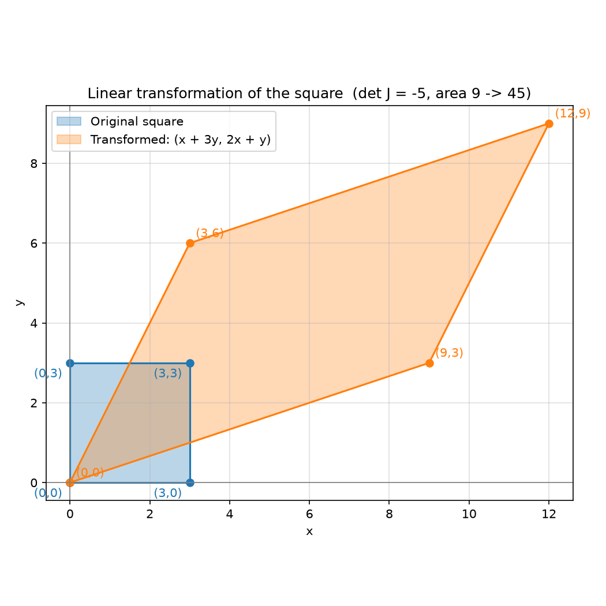
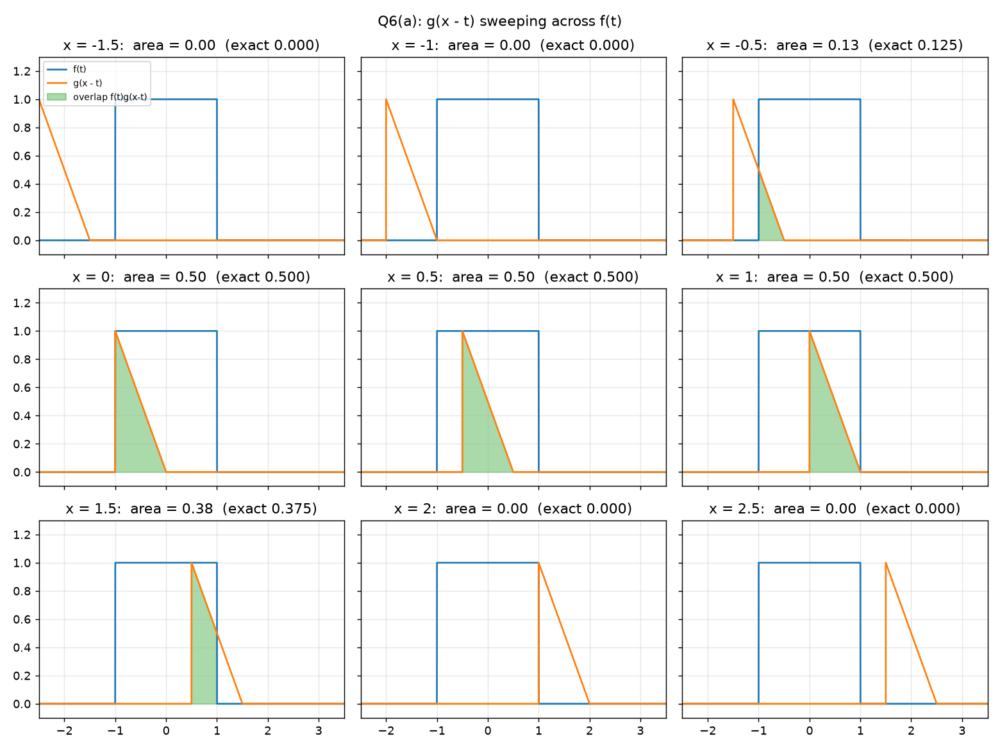
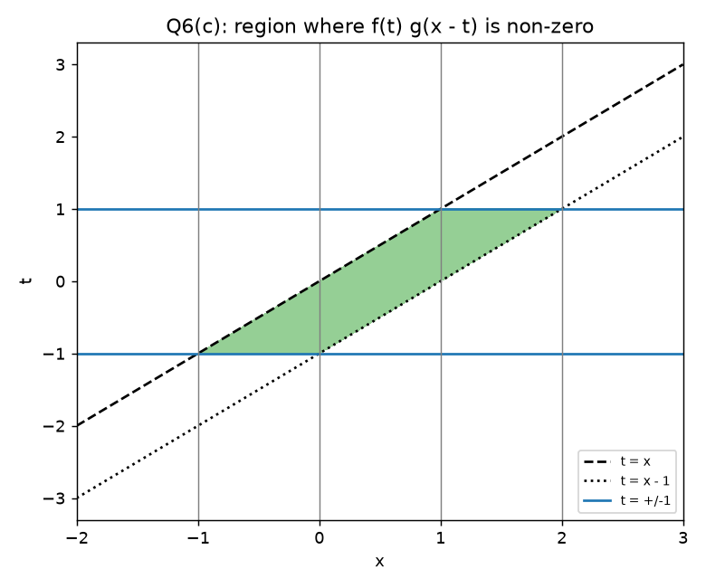
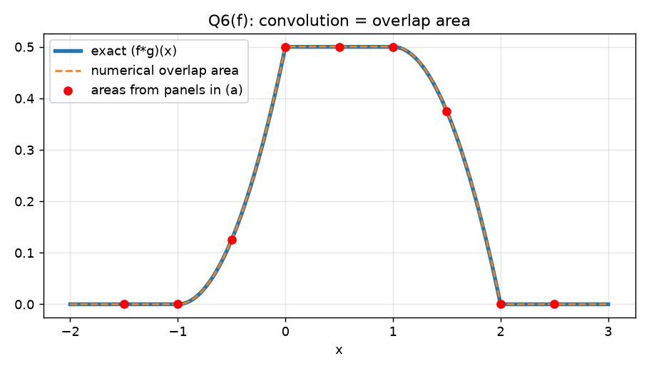

# Intro to Comp Med: Imaging — Homework 3 Solutions

Files in this folder:
- `q2v_linear_transform.py` and `q2v_result.png`: Question 2(v)
- `q6_bonus_convolution.py`, `q6a_sweep.png`, `q6c_domain.png`, `q6f_convolution.png`: Bonus Question 6

---

## 1. Vectors

$$
\vec a = \begin{bmatrix} 4\sqrt3 \\ 2\sqrt5 \\ 2 \\ 6\sqrt2 \end{bmatrix},\qquad
\vec b = \begin{bmatrix} \sqrt3 \\ 2\sqrt5 \\ 3 \\ 4\sqrt2 \end{bmatrix}
$$

### (i) Norms

The Euclidean norm is $\|\vec v\| = \sqrt{\sum_i v_i^2}$.

$$
\|\vec a\| = \sqrt{(4\sqrt3)^2 + (2\sqrt5)^2 + 2^2 + (6\sqrt2)^2}
= \sqrt{48 + 20 + 4 + 72} = \sqrt{144} = \boxed{12}
$$

$$
\|\vec b\| = \sqrt{(\sqrt3)^2 + (2\sqrt5)^2 + 3^2 + (4\sqrt2)^2}
= \sqrt{3 + 20 + 9 + 32} = \sqrt{64} = \boxed{8}
$$

### (ii) Triangle inequality: $\|\vec a + \vec b\| \le \|\vec a\| + \|\vec b\|$

$$
\vec a + \vec b = \begin{bmatrix} 5\sqrt3 \\ 4\sqrt5 \\ 5 \\ 10\sqrt2 \end{bmatrix}
$$

$$
\|\vec a + \vec b\| = \sqrt{75 + 80 + 25 + 200} = \sqrt{380} = 2\sqrt{95} \approx 19.49
$$

$$
\|\vec a\| + \|\vec b\| = 12 + 8 = 20
$$

Since $19.49 \le 20$, the triangle inequality holds. ✔

(Check: $\vec a\cdot\vec b = 12 + 20 + 6 + 48 = 86$, so $\|\vec a+\vec b\|^2 = 144 + 2(86) + 64 = 380$, which matches. Equality would require $\vec a \parallel \vec b$, and these vectors are not parallel.)

---

## 2. Matrices

### (i) Derivative matrix of A

$$
A = \begin{bmatrix}
\tfrac12 x^2 e^x & \sqrt{x^2+1} \\[4pt]
\dfrac{e^{2x}}{x} & x^2\ln(x^3) \\[4pt]
\ln(x^2+1) & \cos(3x^2+1)
\end{bmatrix}
$$

Differentiate each entry:

- $\frac{d}{dx}\left[\tfrac12 x^2 e^x\right] = x e^x + \tfrac12 x^2 e^x = e^x\left(x + \tfrac{x^2}{2}\right)$ (product rule)
- $\frac{d}{dx}\sqrt{x^2+1} = \tfrac12 (x^2+1)^{-1/2}\cdot 2x = \dfrac{x}{\sqrt{x^2+1}}$ (chain rule)
- $\frac{d}{dx}\dfrac{e^{2x}}{x} = \dfrac{2e^{2x}\cdot x - e^{2x}\cdot 1}{x^2} = \dfrac{e^{2x}(2x-1)}{x^2}$ (quotient rule)
- $\frac{d}{dx}\left[x^2\ln(x^3)\right] = 2x\ln(x^3) + x^2\cdot\dfrac{3x^2}{x^3} = 2x\ln(x^3) + 3x \;(= 6x\ln x + 3x)$
- $\frac{d}{dx}\ln(x^2+1) = \dfrac{2x}{x^2+1}$
- $\frac{d}{dx}\cos(3x^2+1) = -\sin(3x^2+1)\cdot 6x = -6x\sin(3x^2+1)$

$$
\boxed{\frac{dA}{dx} = \begin{bmatrix}
e^x\left(x + \tfrac{x^2}{2}\right) & \dfrac{x}{\sqrt{x^2+1}} \\[6pt]
\dfrac{e^{2x}(2x-1)}{x^2} & 2x\ln(x^3) + 3x \\[6pt]
\dfrac{2x}{x^2+1} & -6x\sin(3x^2+1)
\end{bmatrix}}
$$

### (ii) Jacobian of $(x, y) \mapsto (x + 3y,\; 2x + y)$

Let $u = x + 3y$ and $v = 2x + y$.

$$
J = \begin{bmatrix}
\partial u/\partial x & \partial u/\partial y \\
\partial v/\partial x & \partial v/\partial y
\end{bmatrix}
= \boxed{\begin{bmatrix} 1 & 3 \\ 2 & 1 \end{bmatrix}}
$$

In the lecture notation this is $D\phi_A$. For a linear map $\phi_A(x, y) = A\begin{bmatrix} x \\ y \end{bmatrix}$, the Jacobian is the matrix $A$ itself and is the same at every point (Lecture 3, "For linear mappings defined by matrix group the Jacobian is the matrix A").

### (iii) Jacobian determinant

$$
\det J = (1)(1) - (3)(2) = 1 - 6 = \boxed{-5}
$$

### (iv) What the sign and magnitude mean

- **Magnitude** $|\det J|$ is the local area-scaling factor (volume in 3D). Any region's area is multiplied by $|\det J| = 5$. For example, the 3×3 square (area 9) maps to a parallelogram of area 45. If $|\det J| < 1$ the map shrinks areas. If $\det J = 0$ the map collapses the plane onto a line or point, so it is not invertible.
- **Sign** tells you whether orientation is kept. $\det J > 0$ keeps orientation (a counter-clockwise ordering of vertices stays counter-clockwise). $\det J < 0$ flips it, which means the map includes a reflection. Here $\det J = -5 < 0$, so the transformation reflects the plane as well as stretching it.

**How this ties to the lectures.** Lecture 3 uses the Taylor expansion $\phi(x + \delta x) \approx \phi(x) + D\phi\,\delta x$. Up close, any smooth transformation acts like the matrix $D\phi$, so $D\phi$ "determines how the grid deforms." A small square of grid cells is sent to a parallelogram whose area is $|\det D\phi|$ times larger. In anatomy, $|\det D\phi| > 1$ means local expansion and $|\det D\phi| < 1$ means local shrinking (for example, atrophy).

The lectures require $\det D\phi > 0$ for a valid anatomical mapping. A positive determinant means the map is invertible and does not fold the tissue over itself. A negative determinant, like $-5$ here, means the grid has been flipped inside out. That is fine for an abstract linear map, but it would not be an allowed deformation between two anatomies.

Using the polar decomposition from Lecture 2, $A = R_\theta \begin{bmatrix} s_1 & 0 \\ 0 & s_2 \end{bmatrix} R_\gamma$. Rotations have determinant 1, so $\det A = s_1 s_2$. For this $A$ the two scale factors have opposite signs and $|s_1 s_2| = 5$.

### (v) Python script

See `q2v_linear_transform.py`. Output image: `q2v_result.png`.

| Original vertex | Transformed vertex $(x+3y,\,2x+y)$ |
|---|---|
| (0, 0) | (0, 0) |
| (3, 0) | (3, 6) |
| (3, 3) | (12, 9) |
| (0, 3) | (9, 3) |

Program output: `det(T) = -5.0`, original area = 9, transformed area = 45. This matches $|\det J| = 5$. The vertex order also runs the other way around the shape, which is the orientation flip.

---

## 3. Rotation Group

$$
\varphi_\theta = \begin{bmatrix} \cos\theta & -\sin\theta \\ \sin\theta & \cos\theta \end{bmatrix},\qquad
G = \{\varphi_\theta : \theta \in \mathbb R\}
$$

### (a) Closure

$$
\varphi_\theta\varphi_\gamma =
\begin{bmatrix} \cos\theta & -\sin\theta \\ \sin\theta & \cos\theta \end{bmatrix}
\begin{bmatrix} \cos\gamma & -\sin\gamma \\ \sin\gamma & \cos\gamma \end{bmatrix}
=
\begin{bmatrix}
\cos\theta\cos\gamma - \sin\theta\sin\gamma & -(\cos\theta\sin\gamma + \sin\theta\cos\gamma) \\
\sin\theta\cos\gamma + \cos\theta\sin\gamma & \cos\theta\cos\gamma - \sin\theta\sin\gamma
\end{bmatrix}
$$

Use the angle-sum identities $\cos(\theta+\gamma) = \cos\theta\cos\gamma - \sin\theta\sin\gamma$ and $\sin(\theta+\gamma) = \sin\theta\cos\gamma + \cos\theta\sin\gamma$:

$$
\varphi_\theta\varphi_\gamma =
\begin{bmatrix} \cos(\theta+\gamma) & -\sin(\theta+\gamma) \\ \sin(\theta+\gamma) & \cos(\theta+\gamma) \end{bmatrix}
= \varphi_{\theta+\gamma}
$$

Since $\theta + \gamma \in \mathbb R$, we get $\varphi_{\theta+\gamma} \in G$, so $G$ is closed under composition. ✔

### (b) Associativity

Apply closure twice on each side:

$$
\varphi_\theta(\varphi_\gamma\varphi_\omega) = \varphi_\theta\,\varphi_{\gamma+\omega} = \varphi_{\theta+(\gamma+\omega)}
$$

$$
(\varphi_\theta\varphi_\gamma)\varphi_\omega = \varphi_{\theta+\gamma}\,\varphi_\omega = \varphi_{(\theta+\gamma)+\omega}
$$

Real-number addition is associative, so $\theta + (\gamma+\omega) = (\theta+\gamma) + \omega$. The two products are therefore the same matrix. ✔

(Matrix multiplication is associative in general, and this shows it directly.)

### (c) Identity

Take $\theta = 0$:

$$
i = \varphi_0 = \begin{bmatrix} \cos 0 & -\sin 0 \\ \sin 0 & \cos 0 \end{bmatrix} = \begin{bmatrix} 1 & 0 \\ 0 & 1 \end{bmatrix} = I \in G
$$

By closure, $\varphi_\theta\varphi_0 = \varphi_{\theta+0} = \varphi_\theta$ and $\varphi_0\varphi_\theta = \varphi_{0+\theta} = \varphi_\theta$. Multiplying out $\varphi_\theta I$ and $I\varphi_\theta$ directly gives the same result. ✔

### (d) Inverse

For $M = \begin{bmatrix} a & b \\ c & d \end{bmatrix}$, $M^{-1} = \dfrac{1}{ad - bc}\begin{bmatrix} d & -b \\ -c & a \end{bmatrix}$. This exists only if $ad - bc \neq 0$.

**Step 1: the determinant is non-zero, so the inverse exists.**

$$
\det\varphi_\theta = \cos\theta\cdot\cos\theta - (-\sin\theta)(\sin\theta) = \cos^2\theta + \sin^2\theta = 1 \neq 0
$$

**Step 2: apply the formula.** Here $a = \cos\theta$, $b = -\sin\theta$, $c = \sin\theta$, $d = \cos\theta$:

$$
\varphi_\theta^{-1} = \frac{1}{1}\begin{bmatrix} \cos\theta & \sin\theta \\ -\sin\theta & \cos\theta \end{bmatrix}
$$

**Step 3: show this matrix is in $G$.** Cosine is even and sine is odd, so $\cos(-\theta) = \cos\theta$ and $\sin(-\theta) = -\sin\theta$:

$$
\varphi_\theta^{-1} = \begin{bmatrix} \cos(-\theta) & -\sin(-\theta) \\ \sin(-\theta) & \cos(-\theta) \end{bmatrix} = \varphi_{-\theta} \in G
$$

**Step 4: verify both products.**

$$
\varphi_\theta^{-1}\varphi_\theta =
\begin{bmatrix} \cos\theta & \sin\theta \\ -\sin\theta & \cos\theta \end{bmatrix}
\begin{bmatrix} \cos\theta & -\sin\theta \\ \sin\theta & \cos\theta \end{bmatrix}
= \begin{bmatrix}
\cos^2\theta + \sin^2\theta & -\cos\theta\sin\theta + \sin\theta\cos\theta \\
-\sin\theta\cos\theta + \cos\theta\sin\theta & \sin^2\theta + \cos^2\theta
\end{bmatrix} = \begin{bmatrix} 1 & 0 \\ 0 & 1 \end{bmatrix} = i
$$

$$
\varphi_\theta\varphi_\theta^{-1} =
\begin{bmatrix} \cos\theta & -\sin\theta \\ \sin\theta & \cos\theta \end{bmatrix}
\begin{bmatrix} \cos\theta & \sin\theta \\ -\sin\theta & \cos\theta \end{bmatrix}
= \begin{bmatrix}
\cos^2\theta + \sin^2\theta & \cos\theta\sin\theta - \sin\theta\cos\theta \\
\sin\theta\cos\theta - \cos\theta\sin\theta & \sin^2\theta + \cos^2\theta
\end{bmatrix} = i
$$

So $\varphi_\theta^{-1}\varphi_\theta = \varphi_\theta\varphi_\theta^{-1} = i$ and $\varphi_\theta^{-1} = \varphi_{-\theta} \in G$. ✔

All four axioms hold, so the 2D rotations form a group (the group $SO(2)$).

**Check against the lecture definition.** Lecture 2 defines the rotation group as the $2\times2$ orthogonal matrices with $AA^T = id$ and $\det A = 1$. The inverse found in (d) is exactly the transpose, $\varphi_\theta^{-1} = \varphi_\theta^T$, so $\varphi_\theta\varphi_\theta^T = id$. Step 1 also showed $\det\varphi_\theta = 1$. Both conditions hold.

This group works just like the complex numbers of magnitude one from Lecture 2. There, $e^{i\theta}e^{i\gamma} = e^{i(\theta+\gamma)}$, the identity is $1 = e^{i0}$, and the inverse is $e^{-i\theta}$. These match closure, identity and inverse above.

---

## 4. Linearity

A transformation $T$ is **linear** if, for all vectors $\mathbf u, \mathbf v$ and scalars $\alpha, \beta$:

$$
T(\alpha\mathbf u + \beta\mathbf v) = \alpha T(\mathbf u) + \beta T(\mathbf v)
$$

This is additivity plus homogeneity.

### Rotation $\varphi_\theta$ is linear

Let $\mathbf u = (u_1, u_2)$ and $\mathbf v = (v_1, v_2)$.

$$
\varphi_\theta(\alpha\mathbf u + \beta\mathbf v) =
\begin{bmatrix} \cos\theta & -\sin\theta \\ \sin\theta & \cos\theta \end{bmatrix}
\begin{bmatrix} \alpha u_1 + \beta v_1 \\ \alpha u_2 + \beta v_2 \end{bmatrix}
= \begin{bmatrix}
\cos\theta(\alpha u_1 + \beta v_1) - \sin\theta(\alpha u_2 + \beta v_2) \\
\sin\theta(\alpha u_1 + \beta v_1) + \cos\theta(\alpha u_2 + \beta v_2)
\end{bmatrix}
$$

Group the $\alpha$ terms and the $\beta$ terms:

$$
= \alpha\begin{bmatrix} u_1\cos\theta - u_2\sin\theta \\ u_1\sin\theta + u_2\cos\theta \end{bmatrix}
+ \beta\begin{bmatrix} v_1\cos\theta - v_2\sin\theta \\ v_1\sin\theta + v_2\cos\theta \end{bmatrix}
= \alpha\,\varphi_\theta(\mathbf u) + \beta\,\varphi_\theta(\mathbf v) \quad ✔
$$

So rotation is linear. This follows from matrix multiplication distributing over addition and commuting with scalar multiplication.

### Translation $\varphi_t(x, y) = (x + b_x,\; y + b_y)$ is not linear (unless $b_x = b_y = 0$)

$$
\varphi_t(\alpha\mathbf u + \beta\mathbf v) = \begin{bmatrix} \alpha u_1 + \beta v_1 + b_x \\ \alpha u_2 + \beta v_2 + b_y \end{bmatrix}
$$

$$
\alpha\varphi_t(\mathbf u) + \beta\varphi_t(\mathbf v) = \begin{bmatrix} \alpha u_1 + \beta v_1 + (\alpha+\beta)b_x \\ \alpha u_2 + \beta v_2 + (\alpha+\beta)b_y \end{bmatrix}
$$

These are equal only if $(\alpha + \beta - 1)\,\mathbf b = \mathbf 0$ for every $\alpha, \beta$. That forces $\mathbf b = \mathbf 0$.

Lecture 2 ("Translation is Not Linear") splits this into the two properties. Both fail:

- **Scaling (homogeneity):** $\varphi_t\left(\alpha\begin{bmatrix} x \\ y \end{bmatrix}\right) = \begin{bmatrix} \alpha x + b_x \\ \alpha y + b_y \end{bmatrix} \neq \alpha\varphi_t\begin{bmatrix} x \\ y \end{bmatrix} = \begin{bmatrix} \alpha x + \alpha b_x \\ \alpha y + \alpha b_y \end{bmatrix}$ whenever $\alpha \neq 1$.
- **Adding (additivity):** $\varphi_t\begin{bmatrix} x + x' \\ y + y' \end{bmatrix} = \begin{bmatrix} x + x' \\ y + y' \end{bmatrix} + \begin{bmatrix} b_x \\ b_y \end{bmatrix} \neq \varphi_t\begin{bmatrix} x \\ y \end{bmatrix} + \varphi_t\begin{bmatrix} x' \\ y' \end{bmatrix} = \begin{bmatrix} x + x' \\ y + y' \end{bmatrix} + 2\begin{bmatrix} b_x \\ b_y \end{bmatrix}$, because the right side adds $\mathbf b$ twice.

**Simplest counterexample:** any linear map must send the zero vector to zero, because $T(\mathbf 0) = T(0\cdot\mathbf u) = 0\cdot T(\mathbf u) = \mathbf 0$. But $\varphi_t(0, 0) = (b_x, b_y) \neq (0, 0)$.

A concrete check with $\mathbf b = (1, 1)$ and $\alpha = 2$, $\mathbf u = (1, 0)$: $\varphi_t(2\mathbf u) = (3, 1)$, but $2\varphi_t(\mathbf u) = 2(2, 1) = (4, 2)$. These differ.

So translation is **affine**, not linear. Lecture 2 handles this with homogeneous coordinates. The $3\times3$ matrix $\begin{bmatrix} 1 & 0 & b_x \\ 0 & 1 & b_y \\ 0 & 0 & 1 \end{bmatrix}$ acting on $(x, y, 1)$ turns translation into a matrix product, so it can be composed with rotations and scalings like any other matrix.

The vector-field view from Lecture 3 shows the same thing. Translation is $\phi(x) = x + v(x)$ with a constant field $v(x) = \mathbf b$. Rotation has the field $v(x) = (\varphi_\theta - id)\,x$, which is linear in $x$ and is zero at the origin. A constant non-zero field cannot be linear.

---

## 5. Signals and Systems

### (i) Commutativity of convolution

$$
y(x) = \int_{-\infty}^{\infty} g(t)\,h(x - t)\,dt
$$

Substitute $s = x - t$. Then $t = x - s$ and $dt = -ds$. When $t \to -\infty$, $s \to +\infty$, and when $t \to +\infty$, $s \to -\infty$:

$$
y(x) = \int_{+\infty}^{-\infty} g(x - s)\,h(s)\,(-ds) = \int_{-\infty}^{\infty} g(x - s)\,h(s)\,ds
$$

$s$ is a dummy variable, so rename it $t$:

$$
\boxed{y(x) = \int_{-\infty}^{\infty} g(x - t)\,h(t)\,dt} \quad ✔
$$

### (ii) Convolution theorem: $Y(\omega) = H(\omega)X(\omega)$

Start from $y(t) = (x * h)(t) = \displaystyle\int_{-\infty}^{\infty} x(\tau)\,h(t - \tau)\,d\tau$. Take its Fourier transform:

$$
Y(\omega) = \int_{-\infty}^{\infty} y(t)\,e^{-j\omega t}\,dt
= \int_{-\infty}^{\infty}\left[\int_{-\infty}^{\infty} x(\tau)\,h(t - \tau)\,d\tau\right] e^{-j\omega t}\,dt
$$

Swap the order of integration (Fubini). This is valid for absolutely integrable signals:

$$
Y(\omega) = \int_{-\infty}^{\infty} x(\tau)\left[\int_{-\infty}^{\infty} h(t - \tau)\,e^{-j\omega t}\,dt\right] d\tau
$$

In the inner integral, let $s = t - \tau$. Then $t = s + \tau$ and $dt = ds$, and the limits stay the same:

$$
\int_{-\infty}^{\infty} h(s)\,e^{-j\omega(s + \tau)}\,ds = e^{-j\omega\tau}\int_{-\infty}^{\infty} h(s)\,e^{-j\omega s}\,ds = e^{-j\omega\tau}\,H(\omega)
$$

$H(\omega)$ does not depend on $\tau$, so it comes out of the outer integral:

$$
Y(\omega) = H(\omega)\int_{-\infty}^{\infty} x(\tau)\,e^{-j\omega\tau}\,d\tau = \boxed{H(\omega)\,X(\omega)} \quad ✔
$$

Convolution in the time domain is multiplication in the frequency domain.

**Note on notation.** The Lecture 6B slides write the transform in ordinary frequency $f$, as $\int g(x)\,e^{-i2\pi fx}\,dx$. The homework uses angular frequency $\omega$ and $j$. These are the same transform with $\omega = 2\pi f$, and the proof above works unchanged in either form. The lectures use this theorem in the same way. They show $e^{-x}u(x) * e^{x}u(-x) = \tfrac12 e^{-|x|}$ by multiplying the transforms: $\frac{1}{1 + i2\pi f}\cdot\frac{1}{1 - i2\pi f} = \frac{1}{1 + (2\pi f)^2}$.

### (iii) $f(x) = 6e^{-x}u_s(x)$ and $g(x) = e^{-4x}u_s(x)$

$$
(f * g)(x) = \int_{-\infty}^{\infty} 6e^{-t}u_s(t)\; e^{-4(x - t)}u_s(x - t)\,dt
$$

- $u_s(t)$ is non-zero only for $t \ge 0$, so the lower limit becomes $0$.
- $u_s(x - t)$ is non-zero only for $x - t \ge 0$, i.e. $t \le x$, so the upper limit becomes $x$.
- Both conditions need $0 \le t \le x$, which is impossible when $x < 0$. So the result is $0$ for $x < 0$.

The integral reduces to a single definite integral. For $x \ge 0$:

$$
(f * g)(x) = \int_0^x 6e^{-t}e^{-4x}e^{4t}\,dt = 6e^{-4x}\int_0^x e^{3t}\,dt
= 6e^{-4x}\left[\frac{e^{3t}}{3}\right]_0^x = 2e^{-4x}\left(e^{3x} - 1\right)
$$

$$
\boxed{(f * g)(x) = 2\left(e^{-x} - e^{-4x}\right)u_s(x)}
$$

(Check: the result is $0$ at $x = 0$, positive for $x > 0$, and decays to $0$. The total area is $\int_0^\infty 2(e^{-x} - e^{-4x})\,dx = 2(1 - \tfrac14) = \tfrac32$. That equals $(\int f)(\int g) = 6\cdot\tfrac14 = \tfrac32$. ✔)

**Check with Fourier transforms (Lecture 6B method).** The lecture computes $\mathcal F\{e^{-x}u(x)\} = \frac{1}{1 + i2\pi f}$. The same calculation with $e^{-ax}$ gives $\mathcal F\{e^{-ax}u(x)\} = \frac{1}{a + i2\pi f}$. Write $s = i2\pi f$. By part (ii):

$$
\mathcal F\{f * g\} = \frac{6}{1 + s}\cdot\frac{1}{4 + s} = \frac{2}{1 + s} - \frac{2}{4 + s}
$$

(partial fractions: $6 = 2(4 + s) - 2(1 + s)$). Transforming each term back gives $2e^{-x}u(x) - 2e^{-4x}u(x)$, the same answer. ✔

### (iv) Output for $x(t) = u_s(t - 1)$ and $h(t) = e^{-t}u_s(t)$

$$
y(t) = \int_{-\infty}^{\infty} u_s(\tau - 1)\;e^{-(t - \tau)}u_s(t - \tau)\,d\tau
$$

- $u_s(\tau - 1) \ne 0$ requires $\tau \ge 1$.
- $u_s(t - \tau) \ne 0$ requires $\tau \le t$.
- If $t < 1$ there is no overlap, so $y(t) = 0$.

For $t \ge 1$:

$$
y(t) = \int_1^t e^{-(t - \tau)}\,d\tau = e^{-t}\int_1^t e^{\tau}\,d\tau = e^{-t}\left(e^{t} - e^{1}\right) = 1 - e^{-(t - 1)}
$$

$$
\boxed{y(t) = \left(1 - e^{-(t - 1)}\right)u_s(t - 1)}
$$

This is the familiar first-order (RC-type) step response, delayed by 1. It starts at 0 when $t = 1$ and rises toward 1 as $t \to \infty$.

**Check with the Green's-kernel view (Lectures 6–6B).** Lecture 6B shows $\left(1 + \frac{d}{dx}\right)e^{-x}u(x) = \delta(x)$. So $h(t) = e^{-t}u_s(t)$ is the Green's kernel (impulse response) of $A = 1 + \frac{d}{dt}$. Convolving the input with the Green's kernel solves $Ay = x$, so $y$ should satisfy

$$
y'(t) + y(t) = u_s(t - 1), \qquad y(t) = 0 \text{ for } t < 1.
$$

For $t > 1$: $y' = e^{-(t - 1)}$, so $y' + y = e^{-(t - 1)} + 1 - e^{-(t - 1)} = 1$. ✔ For $t < 1$ both sides are $0$. ✔

---

## 6. Bonus: the "sweeping" convolution

$$
f(x) = \begin{cases} 1, & |x| \le 1 \\ 0, & |x| > 1 \end{cases}
\qquad
g(x) = \begin{cases} x, & 0 \le x \le 1 \\ 0, & \text{otherwise} \end{cases}
$$

Script: `q6_bonus_convolution.py`.

### (a) Sketches of $g(x - t)$ over $f(t)$

- $g(-t)$ is $g(t)$ reflected about $t = 0$. It is the ramp $-t$ on $-1 \le t \le 0$: height 1 at $t = -1$, falling to 0 at $t = 0$.
- $g(a - t)$ is that reflected ramp shifted right by $a$. It is non-zero on $[a - 1, a]$, with height 1 at the left end ($t = a - 1$) and 0 at the right end ($t = a$).

Below is $g(x - t)$ (orange) over $f(t)$ (blue) for $x = -1.5, -1, \dots, 2.5$. The green shading is the product $f(t)g(x - t)$, and its area is $(f * g)(x)$.

### (b) Where $g(x - t)$ is non-zero

$g(s) \neq 0$ requires $0 \le s \le 1$ (strictly, $0 < s \le 1$, since $g(0) = 0$). Put $s = x - t$:

$$
0 \le x - t \le 1 \;\Longrightarrow\; -x \le -t \le 1 - x \;\Longrightarrow\; x - 1 \le t \le x
$$

(Multiplying by $-1$ reverses the inequalities.) So $g(x - t)$ is non-zero only in the strip between the lines $t = x - 1$ and $t = x$. ✔

### (c) Where $f(t)g(x - t)$ is non-zero in the $(x, t)$ plane

The product needs both $-1 \le t \le 1$ (from $f$) and $x - 1 \le t \le x$ (from $g$). That region is the parallelogram with vertices $(-1, -1)$, $(0, -1)$, $(2, 1)$ and $(1, 1)$. It is where the diagonal strip meets the horizontal band.

### (d) The three intervals

Take $t$ from $\max(-1,\, x - 1)$ to $\min(1,\, x)$:

| Range of $x$ | Lower limit of $t$ | Upper limit of $t$ | Description |
|---|---|---|---|
| $x < -1$ | none | none | no overlap, so $0$ |
| $-1 \le x \le 0$ | $-1$ | $x$ | ramp partly entering $f$ |
| $0 \le x \le 1$ | $x - 1$ | $x$ | ramp fully inside $f$ |
| $1 \le x \le 2$ | $x - 1$ | $1$ | ramp partly leaving $f$ |
| $x > 2$ | none | none | no overlap, so $0$ |

### (e) The three integrals

Since $f(t) = 1$ on the overlap, $(f * g)(x) = \int (x - t)\,dt$ over the limits above.

**$-1 \le x \le 0$:**

$$
\int_{-1}^{x}(x - t)\,dt = \left[xt - \frac{t^2}{2}\right]_{-1}^{x} = \left(x^2 - \frac{x^2}{2}\right) - \left(-x - \frac12\right) = \frac{x^2}{2} + x + \frac12 = \frac{(x + 1)^2}{2}
$$

**$0 \le x \le 1$:**

$$
\int_{x - 1}^{x}(x - t)\,dt = \left[xt - \frac{t^2}{2}\right]_{x - 1}^{x} = \frac{x^2}{2} - \left(x(x - 1) - \frac{(x - 1)^2}{2}\right) = \frac{x^2}{2} - \frac{x^2 - 1}{2} = \frac12
$$

**$1 \le x \le 2$:**

$$
\int_{x - 1}^{1}(x - t)\,dt = \left[xt - \frac{t^2}{2}\right]_{x - 1}^{1} = \left(x - \frac12\right) - \frac{x^2 - 1}{2} = \frac{-x^2 + 2x}{2} = \frac{1 - (x - 1)^2}{2}
$$

$$
\boxed{(f * g)(x) = \begin{cases}
0, & x < -1 \\
\dfrac{(x + 1)^2}{2}, & -1 \le x \le 0 \\[6pt]
\dfrac12, & 0 \le x \le 1 \\[6pt]
\dfrac{x(2 - x)}{2}, & 1 \le x \le 2 \\
0, & x > 2
\end{cases}}
$$

The pieces join continuously: the value is $\tfrac12$ at $x = 0$ and at $x = 1$, and $0$ at $x = -1$ and $x = 2$. Total area $= \tfrac16 + \tfrac12 + \tfrac13 = 1 = (\int f)(\int g) = 2\cdot\tfrac12$. ✔

### (f) The convolution equals the overlap area

The table compares the overlap areas from the panels in (a) with the formula from (e):

| $x$ | −1.5 | −1 | −0.5 | 0 | 0.5 | 1 | 1.5 | 2 | 2.5 |
|---|---|---|---|---|---|---|---|---|---|
| Overlap area (triangle geometry) | 0 | 0 | 0.125 | 0.5 | 0.5 | 0.5 | 0.375 | 0 | 0 |
| Formula from (e) | 0 | 0 | $\tfrac{(0.5)^2}{2} = 0.125$ | 0.5 | 0.5 | 0.5 | $\tfrac{1.5\cdot0.5}{2} = 0.375$ | 0 | 0 |

For example, at $x = -0.5$ the overlap is a triangle with base 0.5 and height 0.5, so the area is 0.125. At $x = 1.5$ it is a trapezoid on $[0.5, 1]$ with heights 1 and 0.5, so the area is $0.5\cdot\tfrac{1 + 0.5}{2} = 0.375$. The overlap area from the geometry equals the convolution at every point.

