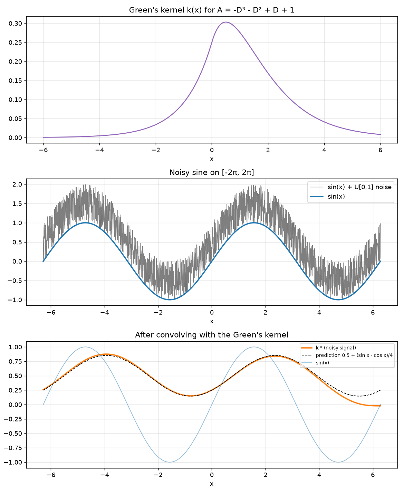

# Intro to Comp Med: Imaging — Homework 6 Solutions

Files in this folder:
- `q5_greens_kernel_filter.py` and `q5_result.png`: Question 5

Notation: $D = \frac{d}{dx}$, $u(x)$ is the unit step, and $\operatorname{sgn}(x)$ is the sign function. Three facts from the lectures are used throughout:

$$
\frac{d}{dx}u(x) = \delta(x), \qquad f(x)\,\delta(x) = f(0)\,\delta(x) \;\text{(sampling property)}, \qquad \frac{d}{dx}|x| = \operatorname{sgn}(x), \qquad \frac{d}{dx}\operatorname{sgn}(x) = 2\delta(x).
$$

Every answer below was also checked symbolically with sympy.

---

## 1. Lagrange multipliers: minimize $f(x,y) = x^2 + 4y^2 - 2x + 8y$ subject to $x + 2y = 7$

Form the Lagrangian with the constraint $g(x, y) = x + 2y - 7 = 0$:

$$
\mathcal L(x, y, \lambda) = x^2 + 4y^2 - 2x + 8y - \lambda(x + 2y - 7)
$$

Set every partial derivative to zero:

$$
\frac{\partial\mathcal L}{\partial x} = 2x - 2 - \lambda = 0 \;\Rightarrow\; \lambda = 2x - 2
$$

$$
\frac{\partial\mathcal L}{\partial y} = 8y + 8 - 2\lambda = 0 \;\Rightarrow\; \lambda = 4y + 4
$$

$$
\frac{\partial\mathcal L}{\partial\lambda} = -(x + 2y - 7) = 0 \;\Rightarrow\; x + 2y = 7
$$

From the first two equations, $2x - 2 = 4y + 4$, so $x = 2y + 3$. Substitute into the constraint: $(2y + 3) + 2y = 7$, so $y = 1$ and $x = 5$. Then $\lambda = 8$.

$$
f(5, 1) = 25 + 4 - 10 + 8 = \boxed{27}
$$

**This point is a minimum.** On the constraint line, $x = 7 - 2y$, so $f = (7 - 2y)^2 + 4y^2 - 2(7 - 2y) + 8y = 8y^2 - 16y + 35$. That is an upward parabola with its lowest point at $y = 1$, where $f = 27$. (Also, $f$ is a convex bowl, so the only critical point on a line must be the minimum.)

---

## 2. Lagrange multipliers: correcting the triangle's angles

The measured angles $m = (63°, 34°, 85°)$ add up to $182°$, but a triangle's angles must add up to $180°$. Following the lecture's least-squares approach (the landmark problems), choose angles $\theta_1, \theta_2, \theta_3$ that stay as close as possible to the measurements while meeting the constraint:

$$
\min_{\theta}\; E(\theta) = (\theta_1 - 63)^2 + (\theta_2 - 34)^2 + (\theta_3 - 85)^2 \quad\text{subject to}\quad \theta_1 + \theta_2 + \theta_3 = 180
$$

$$
\mathcal L = \sum_{i=1}^{3}(\theta_i - m_i)^2 - \lambda\left(\sum_{i=1}^{3}\theta_i - 180\right)
$$

$$
\frac{\partial\mathcal L}{\partial\theta_i} = 2(\theta_i - m_i) - \lambda = 0 \;\Rightarrow\; \theta_i = m_i + \frac{\lambda}{2}
$$

Every angle gets the **same** correction. Apply the constraint:

$$
\sum_i\theta_i = 182 + \frac{3\lambda}{2} = 180 \;\Rightarrow\; \lambda = -\frac43 \;\Rightarrow\; \theta_i = m_i - \frac23
$$

$$
\boxed{\theta_1 = 62\tfrac13° \approx 62.33°, \quad \theta_2 = 33\tfrac13° \approx 33.33°, \quad \theta_3 = 84\tfrac13° \approx 84.33°}
$$

Check: $62\tfrac13 + 33\tfrac13 + 84\tfrac13 = 180$. ✔ The extra $2°$ of error is shared equally among the three angles. $E$ is a sum of squares, which is convex, so this point is the minimum.

---

## 3. Show that $Ak(x) = \delta(x)$

### (a) $A = \frac{d}{dx} + 1$, $\;k(x) = e^{-x}u(x)$

Product rule:

$$
\frac{d}{dx}\left[e^{-x}u(x)\right] = -e^{-x}u(x) + e^{-x}\delta(x) = -e^{-x}u(x) + \delta(x)
$$

The last step uses the sampling property: $e^{-x}\delta(x) = e^{0}\delta(x) = \delta(x)$. Then

$$
Ak = \left[-e^{-x}u(x) + \delta(x)\right] + e^{-x}u(x) = \delta(x) \quad ✔
$$

### (b) $A = -\frac{d}{dx} + 1$, $\;k(x) = e^{x}u(-x)$

$\frac{d}{dx}u(-x) = -\delta(-x) = -\delta(x)$ by the chain rule, and $\delta$ is even. So

$$
\frac{d}{dx}\left[e^{x}u(-x)\right] = e^{x}u(-x) - e^{x}\delta(x) = e^{x}u(-x) - \delta(x)
$$

$$
Ak = -\left[e^{x}u(-x) - \delta(x)\right] + e^{x}u(-x) = \delta(x) \quad ✔
$$

### (c) $A = -\frac{d^2}{dx^2} + 1$, $\;k(x) = \tfrac12 e^{-|x|}$

First derivative:

$$
k'(x) = -\tfrac12\operatorname{sgn}(x)\,e^{-|x|}
$$

Second derivative (product rule, with $\frac{d}{dx}\operatorname{sgn}(x) = 2\delta(x)$ and $\operatorname{sgn}^2(x) = 1$ for $x \ne 0$):

$$
k''(x) = -\tfrac12\left[2\delta(x)\,e^{-|x|} - \operatorname{sgn}^2(x)\,e^{-|x|}\right] = -\delta(x) + \tfrac12 e^{-|x|}
$$

$$
Ak = -k'' + k = \delta(x) - \tfrac12 e^{-|x|} + \tfrac12 e^{-|x|} = \delta(x) \quad ✔
$$

**Check with the Fourier transform (Lecture 6B).** Here $\frac{d}{dx} \leftrightarrow i2\pi f$ and $\delta \leftrightarrow 1$, so $Ak = \delta$ becomes $\hat A(f)\,\hat k(f) = 1$:

| $A$ | $\hat A(f)$ | $\hat k(f) = 1/\hat A(f)$ | $k(x)$ |
|---|---|---|---|
| $D + 1$ | $1 + i2\pi f$ | $\frac{1}{1 + i2\pi f}$ | $e^{-x}u(x)$ |
| $-D + 1$ | $1 - i2\pi f$ | $\frac{1}{1 - i2\pi f}$ | $e^{x}u(-x)$ |
| $-D^2 + 1$ | $1 + (2\pi f)^2$ | $\frac{1}{1 + (2\pi f)^2}$ | $\tfrac12 e^{-\lvert x\rvert}$ |

These are the transform pairs worked out in Lecture 6B. Note also that $-D^2 + 1 = (1 + D)(1 - D)$ and $\tfrac12 e^{-|x|} = e^{-x}u(x) * e^{x}u(-x)$. This is a first example of the result in Question 4.

---

## 4. Kernel of a product of operators

**Claim.** If $A_1k_1 = \delta$ and $A_2k_2 = \delta$, then $k = k_1 * k_2$ satisfies $(A_1A_2)k = \delta$.

**Proof.** $A_1$ is a differential operator in $x$. In $k(x) = \int k_1(x - y)\,k_2(y)\,dy$, only $k_1(x - y)$ depends on $x$, so $A_1$ can be moved inside the integral:

$$
A_1k(x) = \int (A_1k_1)(x - y)\,k_2(y)\,dy = \int \delta(x - y)\,k_2(y)\,dy = k_2(x)
$$

The last step is the sampling property. $A_1$ and $A_2$ have constant coefficients, so they are polynomials in $D$, and polynomials in $D$ commute: $A_1A_2 = A_2A_1$. Therefore

$$
Ak = A_2A_1k = A_2k_2 = \delta(x) \quad ✔
$$

**Fourier view.** $\hat k = \hat k_1\hat k_2 = \frac{1}{\hat A_1}\cdot\frac{1}{\hat A_2} = \frac{1}{\hat A_1\hat A_2} = \frac{1}{\hat A}$. This works because convolution becomes multiplication (HW3, Q5(ii)).

(Remark: the proof only uses constant coefficients, which is what makes the operators commute. The first operator below, $(D + 1)^2$, is not actually self-adjoint because it has odd-order derivatives, but the result still holds.)

### (a) $A = \frac{d^2}{dx^2} + 2\frac{d}{dx} + 1$

Factor it: $A = (D + 1)^2 = (D + 1)(D + 1)$. From Q3(a), the kernel of $D + 1$ is $e^{-x}u(x)$. So

$$
k(x) = e^{-x}u(x) * e^{-x}u(x) = \int_{-\infty}^{\infty} e^{-y}u(y)\,e^{-(x - y)}u(x - y)\,dy
$$

The steps restrict the integral to $0 \le y \le x$, so $k = 0$ for $x < 0$. For $x \ge 0$:

$$
k(x) = \int_0^x e^{-y}e^{-x + y}\,dy = e^{-x}\int_0^x dy = x\,e^{-x}
$$

$$
\boxed{k(x) = x\,e^{-x}\,u(x)}
$$

Check: for $x > 0$, $k' = (1 - x)e^{-x}$ and $k'' = (x - 2)e^{-x}$, so $k'' + 2k' + k = e^{-x}\left[(x - 2) + 2(1 - x) + x\right] = 0$. At $x = 0$, $k$ is continuous and $k'$ jumps by $1$, which produces the $\delta$. ✔

### (b) $A = -\frac{d^3}{dx^3} - \frac{d^2}{dx^2} + \frac{d}{dx} + 1$

Factor by grouping:

$$
-D^3 - D^2 + D + 1 = -D^2(D + 1) + (D + 1) = (D + 1)(1 - D^2)
$$

So $A = A_1A_2$ with $A_1 = D + 1$ (kernel $e^{-x}u(x)$) and $A_2 = -D^2 + 1$ (kernel $\tfrac12 e^{-|x|}$). In full, $A = (1 + D)^2(1 - D)$.

$$
k(x) = \int_{-\infty}^{\infty} e^{-y}u(y)\cdot\tfrac12 e^{-|x - y|}\,dy = \frac12\int_0^\infty e^{-y}e^{-|x - y|}\,dy
$$

**Case $x \ge 0$.** Split at $y = x$:

$$
k(x) = \frac12\left[\int_0^x e^{-y}e^{-(x - y)}\,dy + \int_x^\infty e^{-y}e^{-(y - x)}\,dy\right]
= \frac12\left[x\,e^{-x} + e^{x}\cdot\frac{e^{-2x}}{2}\right] = \frac{(2x + 1)\,e^{-x}}{4}
$$

**Case $x < 0$.** Every $y \ge 0$ is larger than $x$, so $|x - y| = y - x$:

$$
k(x) = \frac12\int_0^\infty e^{-y}e^{-(y - x)}\,dy = \frac12 e^{x}\cdot\frac12 = \frac{e^{x}}{4}
$$

$$
\boxed{k(x) = \begin{cases} \dfrac{(2x + 1)\,e^{-x}}{4}, & x \ge 0 \\[8pt] \dfrac{e^{x}}{4}, & x < 0 \end{cases}}
$$

Check: on each side, $Ak = 0$ (the solutions of the homogeneous equation are $e^{-x}$, $xe^{-x}$ and $e^{x}$). At $x = 0$, $k$ and $k'$ are continuous (both equal $\tfrac14$). $k''$ jumps from $\tfrac14$ to $-\tfrac34$, a jump of $-1$. That equals $1/(\text{leading coefficient } {-1})$, which is exactly what produces $\delta$. ✔ The kernel's total area is $\hat k(0) = 1/\hat A(0) = 1$.

---

## 5. Convolving a noisy sine with the Green's kernel (Python)

Script: `q5_greens_kernel_filter.py`. It uses the kernel from Q4(b):

1. Sample $x \in [-2\pi, 2\pi]$ (2001 points). Build $\sin(x) + \text{noise}$, with noise drawn uniformly from $[0, 1]$ (`np.random.default_rng(0).uniform(0, 1, N)`).
2. Compute $v(x) = (k * p)(x) = \int k(x - y)\,p(y)\,dy$ as a Riemann sum, $v_i = \sum_j k(x_i - x_j)\,p_j\,\Delta x$.
3. Plot the kernel, the noisy sine, and the smoothed result.

**What the result shows.**

- **The noise is removed.** The kernel spreads over several units of $x$, so it averages the rapid random fluctuations away. The output is a smooth curve.
- **The mean of the noise passes through.** The kernel has area $1$ ($\hat k(0) = 1$), and the noise has mean $0.5$. So the output is shifted up by about $0.5$.
- **The sine is shrunk and delayed.** For $\sin x$ the operator acts like $D \to i$, so the kernel multiplies $e^{ix}$ by $\frac{1}{\hat A(i)} = \frac{1}{(1 + i)^2(1 - i)} = \frac{1}{2 + 2i} = \frac{1 - i}{4}$. The output for $\sin x$ is therefore $\frac{\sin x - \cos x}{4} = \frac{\sqrt2}{4}\sin\left(x - \frac{\pi}{4}\right)$: amplitude $\approx 0.35$, shifted right by $45°$. The phase shift happens because this $A$ contains odd derivatives, so its kernel is lopsided. It puts more weight on $y < x$ (the "past"). A symmetric kernel such as $\tfrac12 e^{-|x|}$ would not shift the sine.
- **The prediction matches.** The dashed curve is $0.5 + \frac{\sin x - \cos x}{4}$. In the interior ($|x| < \pi$) the computed result is within $0.02$ of it.
- **The right edge droops.** The signal is treated as zero outside $[-2\pi, 2\pi]$. This mainly matters at the right end, where the kernel's right-hand piece ($e^{x}/4$, area $\tfrac14$) would need samples beyond $2\pi$. The left end also loses samples, but for this signal the missing part happens to cancel out.

---

## 6. $\mathcal J(x) = \dfrac{e^{-|x|}(|x| + 1)}{4} * \dfrac{e^{-|x|}}{2}$

Background: Lecture 6B shows $\tfrac12 e^{-|x|} * \tfrac12 e^{-|x|} = \tfrac14(|x| + 1)e^{-|x|}$. So $\mathcal J$ is the threefold convolution of $\tfrac12 e^{-|x|}$, i.e. the Green's kernel of $(-D^2 + 1)^3$ (see Q4 and Q8).

### (a) The simpler integral form

There are two ways to write the convolution:

$$
\mathcal J(x) = \int_{-\infty}^{\infty}\frac{e^{-|y|}(|y| + 1)}{4}\cdot\frac{e^{-|x - y|}}{2}\,dy
\qquad\text{or}\qquad
\mathcal J(x) = \int_{-\infty}^{\infty}\frac{e^{-|x - y|}(|x - y| + 1)}{4}\cdot\frac{e^{-|y|}}{2}\,dy
$$

The **first** is simpler. The shift $x - y$ appears only inside the plain exponential, not in the polynomial factor:

$$
\boxed{\mathcal J(x) = \frac18\int_{-\infty}^{\infty}(|y| + 1)\,e^{-|y|}\,e^{-|x - y|}\,dy}
$$

### (b) Case $x \ge 0$: $\;y \in (-\infty, 0] \cup [0, x] \cup [x, \infty)$

**(i) The three integrals.** Remove the absolute values on each piece:

| Interval | $\lvert y\rvert$ | $\lvert x - y\rvert$ | Integrand $(\lvert y\rvert + 1)e^{-\lvert y\rvert}e^{-\lvert x - y\rvert}$ |
|---|---|---|---|
| $y \le 0$ | $-y$ | $x - y$ | $(1 - y)\,e^{-x}e^{2y}$ |
| $0 \le y \le x$ | $y$ | $x - y$ | $(1 + y)\,e^{-x}$ |
| $y \ge x$ | $y$ | $y - x$ | $(1 + y)\,e^{x}e^{-2y}$ |

$$
\mathcal J(x) = \frac18\left[e^{-x}\int_{-\infty}^{0}(1 - y)e^{2y}\,dy + e^{-x}\int_0^x(1 + y)\,dy + e^{x}\int_x^\infty(1 + y)e^{-2y}\,dy\right]
$$

**(ii) Compute.** Use $\int_0^\infty t^n e^{-2t}\,dt = \frac{n!}{2^{n+1}}$, i.e. $\int_0^\infty e^{-2t}\,dt = \tfrac12$ and $\int_0^\infty t\,e^{-2t}\,dt = \tfrac14$.

- $I_1 = e^{-x}\int_{-\infty}^0(1 - y)e^{2y}\,dy$. Put $y = -t$: $\int_0^\infty(1 + t)e^{-2t}\,dt = \tfrac12 + \tfrac14 = \tfrac34$. So $I_1 = \tfrac34 e^{-x}$.
- $I_2 = e^{-x}\left[y + \tfrac{y^2}{2}\right]_0^x = e^{-x}\left(x + \tfrac{x^2}{2}\right)$.
- $I_3 = e^{x}\int_x^\infty(1 + y)e^{-2y}\,dy$. Put $y = x + t$: $e^{x}e^{-2x}\int_0^\infty(1 + x + t)e^{-2t}\,dt = e^{-x}\left(\tfrac{1 + x}{2} + \tfrac14\right) = e^{-x}\left(\tfrac{x}{2} + \tfrac34\right)$.

$$
\mathcal J(x) = \frac{e^{-x}}{8}\left[\frac34 + x + \frac{x^2}{2} + \frac{x}{2} + \frac34\right] = \frac{e^{-x}}{8}\cdot\frac{x^2 + 3x + 3}{2}
$$

$$
\boxed{\mathcal J(x) = \frac{e^{-x}\,(x^2 + 3x + 3)}{16}, \quad x \ge 0}
$$

### (b) Case $x < 0$: $\;y \in (-\infty, x] \cup [x, 0] \cup [0, \infty)$

**(i) The three integrals.**

| Interval | $\lvert y\rvert$ | $\lvert x - y\rvert$ | Integrand |
|---|---|---|---|
| $y \le x$ | $-y$ | $x - y$ | $(1 - y)\,e^{-x}e^{2y}$ |
| $x \le y \le 0$ | $-y$ | $y - x$ | $(1 - y)\,e^{x}$ |
| $y \ge 0$ | $y$ | $y - x$ | $(1 + y)\,e^{x}e^{-2y}$ |

$$
\mathcal J(x) = \frac18\left[e^{-x}\int_{-\infty}^{x}(1 - y)e^{2y}\,dy + e^{x}\int_x^0(1 - y)\,dy + e^{x}\int_0^\infty(1 + y)e^{-2y}\,dy\right]
$$

**(ii) Compute.**

- $I_1$: put $y = x - t$. Then $e^{-x}e^{2x}\int_0^\infty(1 - x + t)e^{-2t}\,dt = e^{x}\left(\tfrac{1 - x}{2} + \tfrac14\right) = e^{x}\left(\tfrac34 - \tfrac{x}{2}\right)$.
- $I_2 = e^{x}\left[y - \tfrac{y^2}{2}\right]_x^0 = e^{x}\left(-x + \tfrac{x^2}{2}\right)$.
- $I_3 = e^{x}\left(\tfrac12 + \tfrac14\right) = \tfrac34 e^{x}$.

$$
\mathcal J(x) = \frac{e^{x}}{8}\left[\frac34 - \frac{x}{2} - x + \frac{x^2}{2} + \frac34\right] = \frac{e^{x}}{8}\cdot\frac{x^2 - 3x + 3}{2}
$$

$$
\boxed{\mathcal J(x) = \frac{e^{x}\,(x^2 - 3x + 3)}{16}, \quad x < 0}
$$

As expected, the result is even: the $x < 0$ formula is the $x > 0$ formula with $x$ replaced by $-x$. Both formulas give $\mathcal J(0) = \tfrac{3}{16}$.

### (c) One formula for all $x$, using the sign function

Since $|x| = \operatorname{sgn}(x)\,x$:

$$
\boxed{\mathcal J(x) = \frac{1}{16}\,e^{-\operatorname{sgn}(x)\,x}\left(x^2 + 3\operatorname{sgn}(x)\,x + 3\right) = \frac{e^{-|x|}\left(x^2 + 3|x| + 3\right)}{16}}
$$

Check: total area $= 2\int_0^\infty\frac{(x^2 + 3x + 3)e^{-x}}{16}\,dx = \frac{2(2 + 3 + 3)}{16} = 1$. This equals the product of the two factors' areas, $1\times1$. ✔

---

## 7. $\mathcal K(x) = \dfrac{e^{-|x|}(|x| + 1)}{4} * \dfrac{e^{-|x|}(|x| + 1)}{4} = \mathcal J(x) * \dfrac{e^{-|x|}}{2}$

### (a) The simpler integral form

Again, put the plain exponential in the shifted slot:

$$
\boxed{\mathcal K(x) = \int_{-\infty}^{\infty}\mathcal J(y)\,\frac{e^{-|x - y|}}{2}\,dy = \frac{1}{32}\int_{-\infty}^{\infty}\left(y^2 + 3|y| + 3\right)e^{-|y|}\,e^{-|x - y|}\,dy}
$$

### (b) Case $x \ge 0$: $\;y \in (-\infty, 0] \cup [0, x] \cup [x, \infty)$

**(i) The three integrals.**

$$
\mathcal K(x) = \frac{1}{32}\left[e^{-x}\int_{-\infty}^0(y^2 - 3y + 3)e^{2y}\,dy + e^{-x}\int_0^x(y^2 + 3y + 3)\,dy + e^{x}\int_x^\infty(y^2 + 3y + 3)e^{-2y}\,dy\right]
$$

**(ii) Compute.** Use $\int_0^\infty e^{-2t}\,dt = \tfrac12$, $\int_0^\infty t\,e^{-2t}\,dt = \tfrac14$ and $\int_0^\infty t^2e^{-2t}\,dt = \tfrac14$.

- $I_1$: put $y = -t$. $\int_0^\infty(t^2 + 3t + 3)e^{-2t}\,dt = \tfrac14 + \tfrac34 + \tfrac32 = \tfrac52$. So $I_1 = \tfrac52 e^{-x}$.
- $I_2 = e^{-x}\left(\tfrac{x^3}{3} + \tfrac{3x^2}{2} + 3x\right)$.
- $I_3$: put $y = x + t$. Then $e^{-x}\int_0^\infty\left[t^2 + (2x + 3)t + (x^2 + 3x + 3)\right]e^{-2t}\,dt = e^{-x}\left[\tfrac14 + \tfrac{2x + 3}{4} + \tfrac{x^2 + 3x + 3}{2}\right] = e^{-x}\,\tfrac{x^2 + 4x + 5}{2}$.

$$
\mathcal K(x) = \frac{e^{-x}}{32}\left[\frac52 + \frac{x^3}{3} + \frac{3x^2}{2} + 3x + \frac{x^2}{2} + 2x + \frac52\right] = \frac{e^{-x}}{32}\left[\frac{x^3}{3} + 2x^2 + 5x + 5\right]
$$

$$
\boxed{\mathcal K(x) = \frac{e^{-x}\left(x^3 + 6x^2 + 15x + 15\right)}{96}, \quad x \ge 0}
$$

### (b) Case $x < 0$: $\;y \in (-\infty, x] \cup [x, 0] \cup [0, \infty)$

**(i) The three integrals.**

$$
\mathcal K(x) = \frac{1}{32}\left[e^{-x}\int_{-\infty}^{x}(y^2 - 3y + 3)e^{2y}\,dy + e^{x}\int_x^0(y^2 - 3y + 3)\,dy + e^{x}\int_0^\infty(y^2 + 3y + 3)e^{-2y}\,dy\right]
$$

**(ii) Compute.**

- $I_1$: put $y = x - t$. Then $e^{x}\int_0^\infty\left[t^2 + (3 - 2x)t + (x^2 - 3x + 3)\right]e^{-2t}\,dt = e^{x}\,\tfrac{x^2 - 4x + 5}{2}$.
- $I_2 = e^{x}\left[\tfrac{y^3}{3} - \tfrac{3y^2}{2} + 3y\right]_x^0 = e^{x}\left(-\tfrac{x^3}{3} + \tfrac{3x^2}{2} - 3x\right)$.
- $I_3 = \tfrac52 e^{x}$.

$$
\mathcal K(x) = \frac{e^{x}}{32}\left[-\frac{x^3}{3} + 2x^2 - 5x + 5\right]
$$

$$
\boxed{\mathcal K(x) = \frac{e^{x}\left(-x^3 + 6x^2 - 15x + 15\right)}{96}, \quad x < 0}
$$

Combined form: $\mathcal K(x) = \frac{e^{-|x|}\left(|x|^3 + 6x^2 + 15|x| + 15\right)}{96}$. Check: total area $= \frac{2(6 + 12 + 15 + 15)}{96} = 1$. ✔

---

## 8. Bonus: the Green's function of $\left(-\frac{d^2}{dx^2} + 1\right)^k$

From Question 4, $\mathcal G_k = \underbrace{\tfrac12 e^{-|x|} * \cdots * \tfrac12 e^{-|x|}}_{k}$. The results so far:

| $k$ | $\mathcal G_k(x)$ for $x \ge 0$, i.e. $e^{-x}P_k(x)$ | $P_k(x)$ for $x < 0$ |
|---|---|---|
| 1 | $\tfrac12 e^{-x}$ | $\tfrac12$ |
| 2 | $\tfrac14(x + 1)e^{-x}$ | $\tfrac14(1 - x)$ |
| 3 | $\tfrac{1}{16}(x^2 + 3x + 3)e^{-x}$ (Q6) | $\tfrac{1}{16}(x^2 - 3x + 3)$ |
| 4 | $\tfrac{1}{96}(x^3 + 6x^2 + 15x + 15)e^{-x}$ (Q7) | $\tfrac{1}{96}(-x^3 + 6x^2 - 15x + 15)$ |
| 5 | $\tfrac{1}{768}(x^4 + 10x^3 + 45x^2 + 105x + 105)e^{-x}$ | $\tfrac{1}{768}(x^4 - 10x^3 + 45x^2 - 105x + 105)$ |

(Rows $k = 5$ and $k = 6$ were generated and checked with sympy.)

**Degree.** $P_k$ has degree exactly $k - 1$. There are two ways to see this.

1. *By convolution.* Each extra convolution with $\tfrac12 e^{-|x|}$ includes a middle integral $\int_0^x P(y)\,dy$, as in Q6 and Q7. That raises the degree by one. Starting from degree $0$ at $k = 1$ gives degree $k - 1$.
2. *From the differential equation.* For $x \ne 0$, $\mathcal G_k$ solves $(1 - D)^k(1 + D)^k\mathcal G = 0$. The solutions are $e^{-x}$ and $e^{x}$, each times a polynomial of degree at most $k - 1$. For $x > 0$, decay forces the $e^{-x}$ family, so $\mathcal G_k = e^{-x}P_k(x)$ with $\deg P_k \le k - 1$. The leading coefficient is $\frac{1}{2^k(k - 1)!} \neq 0$, so the degree is exactly $k - 1$.

**Signs of the coefficients.**

- **For $x > 0$, every coefficient of $P_k(x)$ is positive.** Each piece of the convolution integral has a positive integrand, and each integration produces polynomials in $x$ with positive coefficients.
- **For $x < 0$, the coefficients alternate in sign.** Even powers keep a positive coefficient, and odd powers get a negative one. This is because $\mathcal G_k$ is even (a convolution of even functions), so $P_k^{(x<0)}(x) = P_k^{(x>0)}(-x)$. Written in terms of $|x|$, every coefficient is positive in both cases: $\mathcal G_k(x) = e^{-|x|}P_k(|x|)$.
- So $\mathcal G_k(x) > 0$ for every $x$.

**General formula.** This was checked with sympy up to $k = 6$:

$$
\mathcal G_k(x) = \frac{e^{-|x|}}{2^{2k-1}(k - 1)!}\sum_{j=0}^{k-1}\frac{(2k - 2 - j)!}{j!\,(k - 1 - j)!}\,(2|x|)^j
$$

Each step up in $k$ also makes the kernel smoother. $\mathcal G_k$ has $2k - 2$ continuous derivatives, because $\hat{\mathcal G}_k(f) = \frac{1}{\left(1 + (2\pi f)^2\right)^k}$ falls off faster as $k$ grows. This matches the point in the lecture Q&A that the power of the operator sets how smooth the kernel is.
