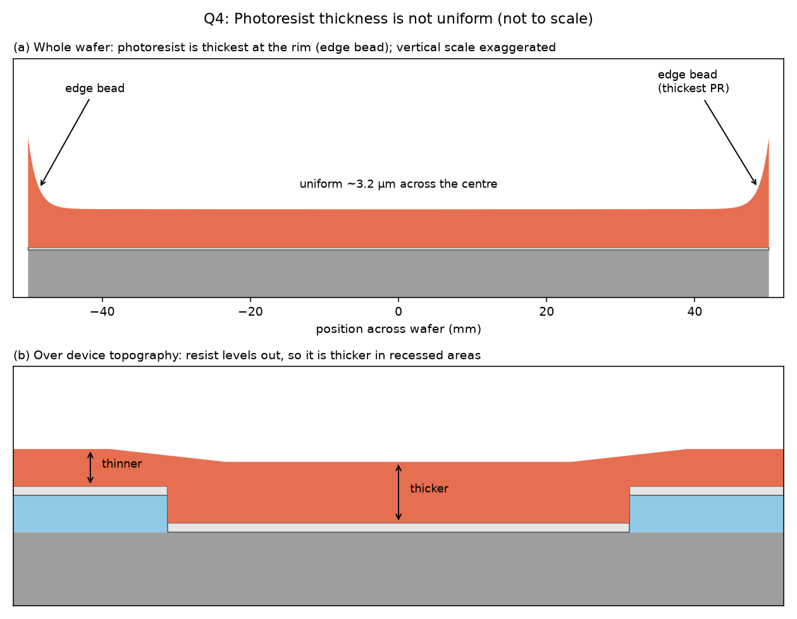
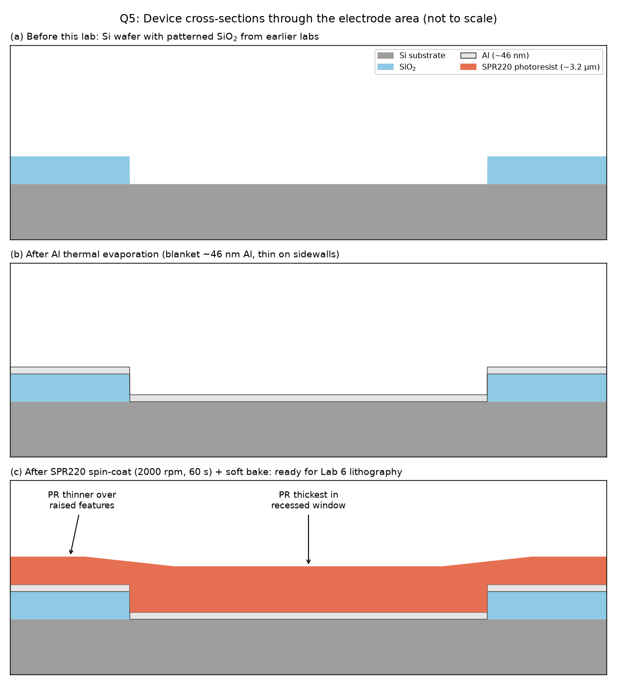

# Lab 5 Postlab: Metal Evaporation (Flow Cytometer)

Files in this folder: `q4_photoresist_thickness.png` and `q5_device_cross_sections.png` (the drawings for Q4 and Q5), and `cross_sections.py` (the script that draws them).

**Our run:**
- **Evaporation:** Al from a tungsten boat, at about $10^{-6}$ torr.
- **Bell jar:** about 450 mm across and 600 mm tall.
- **Photoresist:** SPR220 instead of the SJR5740 in the handout, spun at 2000 rpm for 60 s, then soft-baked at about 105 °C for 7 min.
- **Gauge:** the STC-200 deposition rate controller read **THICK = 0.464 kÅ** at the end of the run.

> **Fill in before submitting:** the Q1 estimate below assumes we loaded **4 pieces of 1/2" Al wire, 1.0 mm in diameter**. If you counted a different number of pieces or used thicker wire, read your value from the table in Q1.

---

## 1. Aluminum thickness: our estimate vs. the gauge

**Gauge reading.** The STC-200 showed $0.464\ \text{kÅ} = 464\ \text{Å} = \mathbf{46.4\ nm}$.

**Estimate from the amount of aluminum loaded.**

*Mass of Al loaded.* Each piece is a 1/2" (1.27 cm) length of 1.0 mm-diameter wire:

$$
m_\text{piece} = \rho\,\pi r^2 L = (2.70\ \text{g/cm}^3)\,\pi\,(0.05\ \text{cm})^2\,(1.27\ \text{cm}) = 0.0269\ \text{g}
$$

Four pieces give $m \approx 0.108\ \text{g}$. The handout says to evaporate until the boat is empty, so we take all of it as evaporated.

*Geometry.* A flat boat acts as a small *surface* source. It emits with a cosine distribution, mostly upward. For a wafer directly above the source at distance $h$, the film thickness is

$$
t = \frac{m}{\pi\rho h^2}
$$

The bell jar is about 600 mm tall and the wafers sit near the top, so take $h \approx 60$ cm:

$$
t = \frac{0.108\ \text{g}}{\pi\,(2.70\ \text{g/cm}^3)\,(60\ \text{cm})^2} = 3.5\times10^{-6}\ \text{cm} \approx \mathbf{35\ nm\ (350\ Å)}
$$

For other loads:

| Pieces of 1/2" wire | 1.0 mm wire: mass → thickness | 1.5 mm wire: mass → thickness |
|---|---|---|
| 2 | 0.054 g → 18 nm | 0.121 g → 40 nm |
| 3 | 0.081 g → 26 nm | 0.182 g → 60 nm |
| **4** | **0.108 g → 35 nm** | 0.242 g → 79 nm |
| 5 | 0.135 g → 44 nm | 0.303 g → 99 nm |
| 6 | 0.162 g → 53 nm | 0.364 g → 119 nm |

*Check against the chamber size.* Suppose instead that the Al coats the whole inside of the bell jar evenly. With diameter 45 cm and height 60 cm, the area is $\pi r^2 + 2\pi r h \approx 1.0\times10^4\ \text{cm}^2$, and 0.108 g gives about **40 nm**. That is close to the estimate above. (If the 450 mm were the radius rather than the diameter, the area would double and the film would be about 17 nm.)

*Uniformity.* With this geometry, the film at a point $x$ away from the wafer centre is $t(x)/t_0 = \left[1 + (x/h)^2\right]^{-2}$. At the edge of a 100 mm wafer ($x = 5$ cm) this is 0.986. So the Al thickness varies by only about 1–2 % across the wafer.

**Comparison.** Our estimate (about 35 nm) and the gauge (46.4 nm) agree to within about 25–30 %. For the gauge to be exactly right, we would have needed about $\pi\rho h^2 t = 0.14$ g of Al, roughly 5 pieces of 1 mm wire. Reasons the two numbers differ:

- **The amount loaded is uncertain.** Wire diameter and piece length were not measured. Part of the Al also wets or alloys with the hot tungsten boat and never evaporates.
- **Simplified geometry.** The boat is neither a perfect point source nor a perfect surface source. A pure point source ($t = m/4\pi\rho h^2$) would give only about 9 nm, so the real emission pattern matters a lot. The source-to-wafer distance was also estimated from the chamber height.
- **The gauge's own settings.** The quartz crystal monitor works out thickness from mass, using the density (2.70 g/cm³ for Al), the Z-ratio (1.08 for Al), and a tooling factor. The tooling factor corrects for the crystal sitting closer to or farther from the source than the wafers. If the controller still had another film's settings, or the default tooling factor of 100 %, its reading would be off by the same factor.
- **Film density.** Evaporated films can be slightly less dense than bulk Al, which makes them a little thicker than the bulk density predicts.

To measure the true thickness, use a profilometer step height after next week's Al etch.

---

## 2. Photoresist used and its thickness

**Resist.** We used **MEGAPOSIT SPR220** (DuPont, formerly Shipley / Rohm and Haas; sold in the US through Kayaku Advanced Materials) instead of the SJR5740 named in the handout. SPR220 is a thick, *positive* i-line resist made for 1–10 µm films. The number after the dash gives the nominal thickness: SPR220-3.0 is about 3 µm and SPR220-7.0 is about 7 µm.

**Thickness.** For spin coating, thickness falls as one over the square root of spin speed: $t \propto 1/\sqrt{\omega}$. SPR220-3.0 gives about 3.0 µm at 2500 rpm, so at 2000 rpm

$$
t \approx 3.0\ \mu\text{m}\times\sqrt{2500/2000} \approx 3.3\ \mu\text{m}
$$

Cleanroom data report **about 3.2 µm at 2000 rpm** for SPR220-3.0. We therefore expect **about 3.2–3.4 µm** in the flat centre of the wafer. Soft-baking drives out solvent and shrinks the film by a few percent.

(If the bottle was SPR220-7.0, the film would be about 7–8 µm at 2000 rpm. Check the label.)

---

## 3. Positive vs. negative photoresist

| | Positive resist | Negative resist |
|---|---|---|
| Effect of exposure | The exposed areas become **more** soluble in developer (a photoactive compound breaks down, e.g. DNQ to a carboxylic acid in a novolac resin) | The exposed areas become **less** soluble (the polymer crosslinks or hardens) |
| What stays after developing | The **unexposed** areas, so the pattern is the **same** as the mask's opaque regions | The **exposed** areas, so the pattern is the **reverse** of the mask |
| Resolution | Better. The film does not swell in developer, so edges stay sharp | Older types swell in solvent developer, which limits resolution. Modern chemically amplified types are much better |
| Sidewalls and uses | Steep sidewalls. Good for etch masks. The standard choice for IC patterning | Can give undercut (re-entrant) profiles, which are good for lift-off. Can be very thick and tough (SU-8) |
| Chemical resistance and adhesion | Moderate | Usually stronger. Crosslinked films can be hard to strip |

**Resists used in industry today, and who makes them:**

- **Positive:**
  - **DuPont (formerly Shipley / Dow):** MEGAPOSIT SPR220 (the one we used), S1813 / S1800 series, SPR955.
  - **Merck (EMD Performance Materials, AZ brand):** AZ 1512, AZ 4620, AZ 10XT.
  - Others: TOK (Tokyo Ohka Kogyo) THMR-iP series, and JSR.
- **Negative:**
  - **Kayaku Advanced Materials (formerly MicroChem):** SU-8 and KMPR.
  - **Merck (AZ brand):** AZ nLOF 2020 / 2070, a lift-off resist.
  - Others: Futurrex NR9 series, and micro resist technology ma-N 1400.

---

## 4. Is the photoresist the same thickness everywhere?

**No.** The resist is close to uniform across the flat centre of the wafer, but it varies in two places:

1. **Edge bead (thickest overall).** Resist piles up in a ridge within about 1–3 mm of the wafer rim, and near the flat. Two things cause it. Surface tension holds liquid at the edge as it is flung outward. Solvent also evaporates faster at the rim, so the resist there thickens before it can level out. The bead can be 2–5 times as thick as the film in the centre. That matters next week: it can stop the mask from sitting flat on the wafer during contact exposure.
2. **Over the device's surface relief.** Spun resist tends to level itself out. It is **thicker in low areas** (windows or trenches from earlier steps) and **thinner over raised features**, and thinnest right at the top corners of steps. Exposure and development times must be long enough to clear the thickest parts.

---

## 5. Important cross-sections after this lab

- **(a) Starting point.** The Si wafer with the patterned SiO₂ from earlier labs.
- **(b) After evaporation.** A blanket Al film, about 46 nm thick, covers everything. Evaporation travels in straight lines, so the vertical sidewalls get very little Al. The Al may even break at tall steps.
- **(c) After spin-coating and soft bake.** About 3.2 µm of SPR220 covers the Al. It is thicker in recessed areas and builds up at the wafer edge. The wafer is now ready for next week's lithography, which will pattern the Al into electrodes.

*(The drawing shows a generic oxide window as the earlier pattern. If your earlier layers were different, such as etched channels or another oxide pattern, keep the same Al and PR layers but redraw the layers underneath to match your notebook.)*

---

## 6. Why pump down to $1\times10^{-6}$ torr before evaporating?

1. **Long mean free path, so atoms fly straight.** The mean free path of gas molecules is $\lambda = \frac{kT}{\sqrt2\,\pi d^2 P}$. At $10^{-6}$ torr and room temperature, with $d \approx 0.37$ nm:

   $$
   \lambda = \frac{(1.38\times10^{-23})(295)}{\sqrt2\,\pi\,(3.7\times10^{-10})^2\,(1.33\times10^{-4}\ \text{Pa})} \approx 50\ \text{m}
   $$

   That is about 80 times the 0.6 m path from source to wafer. Only $1 - e^{-0.6/50} \approx 1\%$ of Al atoms hit a gas molecule on the way, so they arrive in a straight line. This gives a predictable, directional film. At higher pressure, the atoms would scatter, lose energy, and form a porous, poorly controlled deposit.
2. **Film purity and adhesion.** Even at $10^{-6}$ torr, background gas (mostly water vapour and O₂) can cover a surface with one molecular layer in about 1 s. At higher pressures this happens much faster. Aluminum reacts readily with oxygen and water, so a poor vacuum would leave oxide and hydroxide mixed into the film. That raises the resistivity of our electrodes and weakens adhesion. Lower pressure means fewer contaminants arriving compared with Al atoms.
3. **Protecting the hot source.** The tungsten boat and the molten Al run at over 1000 °C. With too much oxygen or water present, the boat and the charge would oxidize, which can burn out the boat and cause spitting.
4. **Stable process and equipment.** A clean, low base pressure makes the deposition rate repeatable. It is also needed for the ion gauge filament and the crystal monitor to work properly.

---

### Sources

- [SPR220 thickness at 2000 rpm (University of Michigan LNF, CEE 200X spinner)](https://lnf-wiki.eecs.umich.edu/wiki/index.php?title=CEE_200X_photoresist_spinner_1&mobileaction=toggle_view_desktop)
- [SPR-220-3.0 optimization (UCSB Nanofab)](https://wiki.nanofab.ucsb.edu/w/images/0/01/SPR-220-3.0_OptimizationNew.pdf)
- [MEGAPOSIT SPR220 series (Kayaku Advanced Materials)](https://kayakuam.com/products/megaposit-spr220-series-thick-i-line-photoresists/)
- [SPR220 data sheet (UPenn copy)](https://www.seas.upenn.edu/~nanosop/documents/SPR_220_Data_Sheet.pdf)
